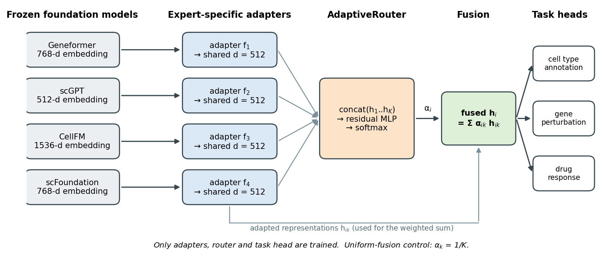

# HeteroSC

**Adaptive expert orchestration of heterogeneous single-cell foundation models.**

[](https://doi.org/10.5281/zenodo.23153537)


Single-cell foundation models (ScFMs) such as Geneformer, scGPT, CellFM and scFoundation differ in architecture, pre-training objective, input encoding and
gene vocabulary, and no single model is best everywhere. **HeteroSC** keeps these models *frozen*, maps each model's representation into a shared latent space with an
**expert-specific adapter**, and lets an **input-dependent router** decide how much each expert contributes for every cell, gene or cell line.
New experts can be added with another adapter, without retraining any foundation model.



> **Paper:** *Can Heterogeneous Single-Cell Foundation Models Work Better Together? HeteroSC for Adapter-Based Integration and Orchestration of Complementary ScFM Experts.*
> Nursyafi F. S., Hanum U. L., Fuadah Y. N., Lim K. M. (manuscript under review).
> **Data:** [10.5281/zenodo.23153537](https://doi.org/10.5281/zenodo.23153537)

## The idea in 30 seconds

For an input $i$ (a cell, a gene or a cell line) and expert $k$ with frozen embedding $e_i^k$:

$$h_i^k = f_k(e_i^k), \qquad \alpha_i = \mathrm{softmax}\big(\mathrm{MLP}([h_i^1;\dots;h_i^K])\big), \qquad h_i = \sum_k \alpha_{ik}\, h_i^k .$$

Only the adapters $f_k$, the router and a small task head are trained. A **uniform-fusion control** ($\alpha_{ik}=1/K$, same adapters) separates the effect of
*routing* from the effect of merely *having several representations*. Three tasks use the same core: **cell type annotation** (routing per cell), **gene perturbation
prediction** with GEARS (routing per gene) and **unseen-drug response prediction** (routing per cell line, leave-drug-out validation).
Routing weights are predictive contributions under the training objective, not measures of model quality. See [`docs/theory.md`](docs/theory.md).

## Install

```bash
git clone https://github.com/<your-org>/HeteroSC.git && cd HeteroSC
python -m venv .venv && source .venv/bin/activate            # Windows: .venv\Scripts\activate
pip install -e ".[dev]"
pytest -q                                                    # about 20 s on a CPU
```

## Try it in two minutes (CPU, no downloads)

Open [`notebooks/00_quickstart_synthetic.ipynb`](notebooks/00_quickstart_synthetic.ipynb): synthetic complementary experts, HeteroSC vs the uniform control, routing diagnostics and the zero-shot kNN probe.

```python
from heterosc import AnnotationConfig, AnnotationTrainer, HeteroSCClassifier, make_loaders

cfg = AnnotationConfig(expert_dims={"geneformer": 768, "scgpt": 512, "cellfm": 1536, "scfoundation": 768},
                       num_classes=13)                       # fusion="adaptive" (default) or "uniform"
train, val, test = make_loaders(embeddings, labels, split, cfg.batch_size)   # embeddings: {expert: (n_cells, dim)}
model = HeteroSCClassifier(cfg)
result = AnnotationTrainer(model, cfg).fit(train, val, test, labels[split == "train"])
result["test"]["expert_utilization"]                         # mean routing weight per expert
```

## Tutorials

| Notebook | What it does | Needs |
|---|---|---|
| [`00_quickstart_synthetic`](notebooks/00_quickstart_synthetic.ipynb) | the whole idea on synthetic data | CPU |
| [`01_download_and_prepare_data`](notebooks/01_download_and_prepare_data.ipynb) | download from Zenodo, verify MD5, inspect the data | internet, 7-Zip/unrar |
| `02a` – `02d` [extract embeddings](notebooks) | frozen embeddings from Geneformer, scGPT, scFoundation, CellFM | GPU, each model's repo + checkpoint |
| [`03_cell_annotation`](notebooks/03_cell_annotation.ipynb) | HeteroSC vs uniform vs single experts, fine-tuned and zero-shot kNN, routing per cell type | embeddings from 02 |
| [`04_drug_response`](notebooks/04_drug_response.ipynb) | 10-fold **leave-drug-out** prediction with a GCN drug encoder | embeddings from 02 |
| [`05_gene_perturbation`](notebooks/05_gene_perturbation.ipynb) | HeteroSC inside GEARS, Fusion Ladder (15 expert combinations) | GEARS, gene tables |
| [`06_routing_analysis`](notebooks/06_routing_analysis.ipynb) | routing weights, entropy and adaptive-vs-uniform across tasks | outputs of 03–05 |

The foundation models' checkpoints are not redistributed; get them from the official releases:
[Geneformer](https://huggingface.co/ctheodoris/Geneformer) · [scGPT](https://github.com/bowang-lab/scGPT) · [scFoundation](https://github.com/biomap-research/scFoundation) · [CellFM](https://github.com/biomed-AI/CellFM) · [GEARS](https://github.com/snap-stanford/GEARS).
Each has heavy, specific dependencies, so extraction runs in a separate environment per model (templates in [`envs/`](envs)).

## Data

The record [10.5281/zenodo.23153537](https://doi.org/10.5281/zenodo.23153537) contains the processed annotation datasets with their train/validation/test assignment, the drug-response tables with the leave-drug-out folds,
Norman/Adamson in GEARS format and the GEARS split. Raw GDSC dose-response files and all embeddings and weights are *not* included. Details, file lists and attribution: [`docs/data.md`](docs/data.md).

```python
from heterosc.zenodo import download_data
download_data("data")          # ~650 MB, MD5-verified
```

## Repository layout

```
src/heterosc/   modules (adapter, router, fusion) · losses · annotation · drug_response · perturbation
                zenodo / gdsc (data download) · extraction/ (4 foundation models) · plots · synthetic
notebooks/      00–06 tutorials          scripts/   command-line versions
docs/           theory · data · reproducibility · method-to-code map          tests/   unit tests (run in CI)
```

## Status

| Component | State |
|---|---|
| Core modules, losses, annotation, kNN probe, drug-response training (with leave-drug-out guard), gene-level fusion module, Zenodo download, notebook 00 | unit-tested and run on CPU (`pytest`) |
| Foundation-model extraction (`heterosc.extraction`), GEARS integration notebook (05) | ported from working research notebooks; need each model's code, checkpoint and a GPU; **not exercised by the tests** |
| Notebooks 01–04, 06 | written against the tested API; run them on your data and report problems as issues |

Default training settings are in [`docs/reproducibility.md`](docs/reproducibility.md). You retrain everything from the foundation-model embeddings, so exact numbers will vary with seeds, hardware and library versions.

## Citation

If you use this code or data, please cite the manuscript (under review) and the data record:

> Nursyafi FS, Hanum UL, Fuadah YN, Lim KM. *HeteroSC benchmark data: processed single-cell annotation datasets, drug-response tables, perturbation splits and data partitions.* Zenodo. https://doi.org/10.5281/zenodo.23153537

See [`CITATION.cff`](CITATION.cff). Third-party data keep the licences and terms of their original providers (see [`docs/data.md`](docs/data.md)).

## License

MIT (see [`LICENSE`](LICENSE)) for the code in this repository. Pre-trained models and datasets keep their own licences.
